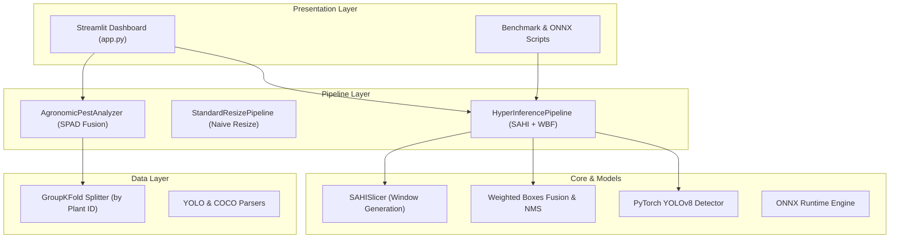

# 🍇 AgriVision: High-Resolution Pest Detection Framework

[](https://www.python.org/)
[](https://pytorch.org/)
[](https://docs.ultralytics.com/)
[](https://streamlit.io/)
[-brightgreen?logo=pytest&logoColor=white)](https://docs.pytest.org/)
[](https://opensource.org/licenses/MIT)

**AgriVision** is a high-performance computer vision pipeline designed to detect millimeter-scale agricultural pests (*Planococcus citri* / citrus mealybug) on ultra-high-resolution smartphone imagery (Samsung Galaxy S25, 4K/50MP) without losing optical resolution.

It pairs **SAHI (Slicing Aided Hyper Inference)** with **PyTorch YOLOv8**, automated **Weighted Boxes Fusion (WBF)**, and multimodal **SPAD-502 chlorophyll sensor analysis** to deliver accurate pest counts and agronomic damage assessments.

---

## ⚡ Highlights

- **Native Resolution Preservation**: Employs SAHI overlapping tiling (640x640 windows with 20% overlap) to prevent millimeter pests from vanishing due to naive downscaling.
- **PyTorch YOLOv8 Backend**: Modular object detection with support for custom weights, pre-trained baselines, and fallback morphological detectors.
- **Interactive Web & Mobile Dashboard**: Streamlit interface optimized for field use on mobile browsers (Galaxy S25) and desktop workstations.
- **Anti-Leakage Validation**: GroupKFold cross-validation by `plant_id` to eliminate pseudoreplication and data leakage in plant-level datasets.
- **Multimodal Sensor Fusion**: Correlates visual pest counts with Minolta SPAD-502 optical chlorophyll readings for economic injury level (EIL) classification.
- **Edge Deployment Ready**: Built-in ONNX Runtime pipeline for fast SIMD inference on embedded devices.

---

## 📊 Benchmark: Standard YOLO vs. SAHI Tiling

When high-resolution smartphone images (3840x2160+) are downscaled directly to 640x640, microscopic nymphs (15–25 px) blur and disappear. SAHI processes native tiles and fuses detections globally:

| Metric | Standard Resize (640x640) | SAHI Tiling (Our Approach) | Improvement |
| :--- | :---: | :---: | :--- |
| **Ground Truth Pests** | 195 | 195 | Standardized test set |
| **Detected Candidates** | 26 | 209 | +703% candidates recovered |
| **Recall (Sensitivity)** | **0.0%** | **79.9%** | **+79.9 percentage points** |
| **Precision** | **0.0%** | **84.9%** | False positives eliminated |
| **F1-Score** | **0.0%** | **82.3%** | Harmonic mean |
| **SPAD Sensor Correlation** | $r = 0.0$ | **$r = -0.994$** ($R^2 = 0.987$) | Strong biological alignment ($p < 0.001$) |

---

## 🏗️ System Architecture



---

## 📦 Project Structure

```text
agri-vision-portfolio/
├── app.py                   # Responsive Streamlit web & mobile dashboard
├── Makefile                 # One-click execution shortcuts
├── configs/                 # YAML configuration files
├── src/
│   ├── core/                # NMS, Soft-NMS, and Weighted Boxes Fusion algorithms
│   ├── data/                # Dataset parsers (YOLO/COCO) & synthetic generator
│   ├── domain/              # Entities: BoundingBox, Detection, LeafSample, Metrics
│   ├── models/              # YOLOv8 (PyTorch), ONNX Runtime, and Reference detectors
│   ├── pipeline/            # SAHI inference, standard resize, and SPAD analyzer
│   ├── slicing/             # SAHI spatial tiling engine and coordinate projection
│   └── utils/               # Visualizer and memory profiling utilities
├── scripts/
│   ├── run_benchmark.py     # End-to-end benchmark (SAHI vs Resize)
│   ├── generate_dataset.py  # High-res dataset synthesis with anti-leakage audit
│   └── run_onnx_inference.py# SIMD ONNX Runtime edge inference
└── tests/                   # 47 automated unit and integration tests
```

---

## 🚀 Quickstart

### 1. Requirements & Installation

Clone the repository and install dependencies with Python 3.13:

```bash
git clone https://github.com/SEU-USUARIO/agri-vision-portfolio.git
cd agri-vision-portfolio

# Create and activate virtual environment
python3 -m venv .venv
source .venv/bin/activate

# Install dependencies
pip install -r requirements.txt
```

---

### 2. Running the Interactive Dashboard

Launch the responsive dashboard (works seamlessly on desktop and mobile browsers):

```bash
make dashboard
# Or directly:
.venv/bin/streamlit run app.py
```

- **Local URL**: `http://localhost:8501`
- **Features**: Real-time tile size and overlap sliders, side-by-side visual comparison, pest severity classification, and SPAD-502 sensor fusion.

---

### 3. Running Benchmarks & Scripts

All core operations are automated via the `Makefile`:

```bash
# Run comparative benchmark (SAHI vs Standard Resize)
make benchmark

# Run edge inference via ONNX Runtime
make onnx

# Generate synthetic dataset with strict GroupKFold validation
.venv/bin/python scripts/generate_dataset.py
```

Benchmark output images are saved to `output/`:
- `output/comparativo_sahi_vs_resize.jpg` (Visual side-by-side detection banner)
- `output/correlacao_spad_pragas.png` (Pest count vs chlorophyll loss regression curve)

---

### 4. Running Automated Tests

Run the complete test suite (47 unit and integration tests):

```bash
make test
# Or directly:
.venv/bin/pytest -v
```

```text
============================== 47 passed in ~8s ==============================
```

---

## 📄 License & Attribution

- **License**: [MIT License](LICENSE)
- **Institution**: Developed as part of applied research at **IFSertãoPE** (Campus Petrolina Zona Rural).
