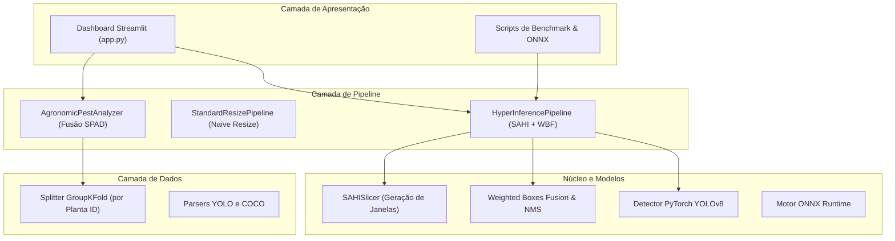
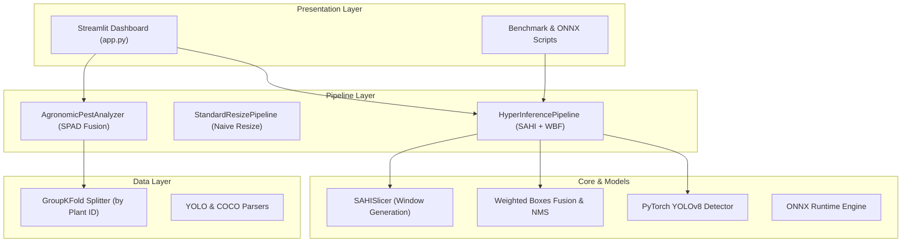

# 🍇 AgriVision: High-Resolution Pest Detection Framework

<div align="center">

**Selecione o idioma / Select language:**  
[-009c3b?style=for-the-badge)](#-português-brasil)
[](#-english-version)

</div>

---

<details open>
<summary><h2 style="display: inline-block;">🇧🇷 Português (Brasil)</h2> <i>(Clique para recolher/expandir)</i></summary>

<br/>

[](https://www.python.org/)
[](https://pytorch.org/)
[](https://docs.ultralytics.com/)
[](https://streamlit.io/)
[-brightgreen?logo=pytest&logoColor=white)](https://docs.pytest.org/)
[](https://opensource.org/licenses/MIT)

O **AgriVision** é um pipeline de visão computacional de alto desempenho projetado para detectar pragas agrícolas em escala milimétrica (*Planococcus citri* / cochonilha-farinhenta da videira) em imagens de ultra-alta resolução capturadas por smartphones (Samsung Galaxy S25, 4K/50MP) sem perda de resolução óptica.

O projeto combina **SAHI (Slicing Aided Hyper Inference)** com **PyTorch YOLOv8**, algoritmo de fusão **Weighted Boxes Fusion (WBF)** e análise multimodal com o sensor óptico de clorofila **SPAD-502** para entregar contagens precisas e diagnósticos fitossanitários.

---

### ⚡ Destaques Técnicos

- **Preservação de Resolução Nativa**: Utiliza janelamento SAHI com sobreposição (tamanho 640x640 com 20% de overlap) para impedir que ninfas milimétricas desapareçam no redimensionamento padrão.
- **Backend Modular PyTorch YOLOv8**: Suporte para pesos customizados, modelos pré-treinados e detector morfológico de referência.
- **Dashboard Web & Mobile Responsivo**: Interface em Streamlit otimizada tanto para telas de smartphones no campo (Galaxy S25) quanto para computadores.
- **Validação Anti-Vazamento (Anti-Leakage)**: Divisão estrita por GroupKFold baseada em `plant_id`, eliminando pseudorrepetição entre conjuntos de treino e teste.
- **Fusão com Sensor Fisiológico (SPAD-502)**: Correlaciona contagem visual de pragas com leituras de densidade óptica de clorofila para estimativa de nível de dano econômico (NDE).
- **Pronto para Dispositivos de Borda**: Pipeline com suporte a inferência acelerada por SIMD via ONNX Runtime.

---

### 📊 Benchmark: YOLO Padrão vs. SAHI Tiling

Quando fotos em alta definição (3840x2160+) são comprimidas diretamente para 640x640, ninfas minúsculas (15 a 25 pixels) são destruídas pela interpolação. O SAHI processa fatias na resolução nativa e funde as predições globalmente:

| Métrica de Avaliação | Redimensionamento Padrão (640x640) | SAHI Tiling (Nossa Abordagem) | Impacto Prático |
| :--- | :---: | :---: | :--- |
| **Pragas no Gabarito (Ground Truth)** | 195 | 195 | Conjunto de teste padronizado |
| **Candidatos Detectados** | 26 | 209 | +703% candidatos recuperados |
| **Recall (Sensibilidade)** | **0.0%** | **79.9%** | **+79.9 pontos percentuais** |
| **Precisão** | **0.0%** | **84.9%** | Falsos positivos eliminados |
| **F1-Score** | **0.0%** | **82.3%** | Média harmônica balanceada |
| **Correlação Sensor SPAD** | $r = 0.0$ | **$r = -0.994$** ($R^2 = 0.987$) | Forte alinhamento biológico ($p < 0.001$) |

---

### 🏗️ Arquitetura do Sistema



---

### 📦 Estrutura do Repositório

```text
agri-vision-portfolio/
├── app.py                   # Dashboard web e mobile responsivo em Streamlit
├── Makefile                 # Atalhos de execução (make test, make dashboard, etc.)
├── configs/                 # Configurações do pipeline em YAML
├── src/
│   ├── core/                # Algoritmos de NMS, Soft-NMS e Weighted Boxes Fusion
│   ├── data/                # Parsers de anotações (YOLO/COCO) e gerador sintético
│   ├── domain/              # Entidades centrais: BoundingBox, Detection, LeafSample
│   ├── models/              # YOLOv8 (PyTorch), ONNX Runtime e Detector Morfológico
│   ├── pipeline/            # Orquestração SAHI, resize padrão e analisador SPAD
│   ├── slicing/             # Motor de janelamento espacial e reprojeção de coordenadas
│   └── utils/               # Utilitários de desenho e profiler de memória
├── scripts/
│   ├── run_benchmark.py     # Benchmark comparativo completo (SAHI vs Resize)
│   ├── generate_dataset.py  # Síntese de dados com auditoria anti-vazamento
│   └── run_onnx_inference.py# Inferência SIMD em borda via ONNX Runtime
└── tests/                   # 47 testes automatizados com pytest
```

---

### 🚀 Guia Rápido de Instalação e Execução

#### 1. Clonar e Configurar Ambiente
```bash
git clone https://github.com/dzati1910/agri-vision.git
cd agri-vision

# Criar e ativar o ambiente virtual
python3 -m venv .venv
source .venv/bin/activate

# Instalar dependências
pip install -r requirements.txt
```

#### 2. Executar o Dashboard Interativo (Desktop & Mobile)
```bash
make dashboard
# Ou diretamente:
.venv/bin/streamlit run app.py
```
- Acesse no navegador: `http://localhost:8501` (ou pelo IP local no celular).
- Permite upload de fotos, ajuste de limiares de confiança/IoU, visualização lado a lado e diagnóstico de severidade.

#### 3. Executar Benchmarks e Scripts
```bash
# Rodar benchmark comparativo (SAHI vs Resize)
make benchmark

# Executar inferência em borda com ONNX
make onnx

# Gerar dataset sintético com validação GroupKFold
.venv/bin/python scripts/generate_dataset.py
```
As imagens comparativas de saída são salvas em `output/`:
- `output/comparativo_sahi_vs_resize.jpg` (Banner visual comparativo)
- `output/correlacao_spad_pragas.png` (Curva de correlação contagem vs SPAD)

#### 4. Executar os Testes Automatizados (47 testes)
```bash
make test
# Ou diretamente:
.venv/bin/pytest -v
```

---

### 📄 Licença e Atribuição Institucional
- **Licença**: [MIT License](LICENSE)
- **Instituição**: Pesquisa aplicada desenvolvida no **IFSertãoPE** (Campus Petrolina Zona Rural).

</details>

---

<details>
<summary><h2 style="display: inline-block;">🇺🇸 English Version</h2> <i>(Click to expand/collapse)</i></summary>

<br/>

[](https://www.python.org/)
[](https://pytorch.org/)
[](https://docs.ultralytics.com/)
[](https://streamlit.io/)
[-brightgreen?logo=pytest&logoColor=white)](https://docs.pytest.org/)
[](https://opensource.org/licenses/MIT)

**AgriVision** is a high-performance computer vision pipeline designed to detect millimeter-scale agricultural pests (*Planococcus citri* / citrus mealybug) on ultra-high-resolution smartphone imagery (Samsung Galaxy S25, 4K/50MP) without losing optical resolution.

It pairs **SAHI (Slicing Aided Hyper Inference)** with **PyTorch YOLOv8**, automated **Weighted Boxes Fusion (WBF)**, and multimodal **SPAD-502 chlorophyll sensor analysis** to deliver accurate pest counts and agronomic damage assessments.

---

### ⚡ Highlights

- **Native Resolution Preservation**: Employs SAHI overlapping tiling (640x640 windows with 20% overlap) to prevent millimeter pests from vanishing due to naive downscaling.
- **PyTorch YOLOv8 Backend**: Modular object detection with support for custom weights, pre-trained baselines, and fallback morphological detectors.
- **Interactive Web & Mobile Dashboard**: Streamlit interface optimized for field use on mobile browsers (Galaxy S25) and desktop workstations.
- **Anti-Leakage Validation**: GroupKFold cross-validation by `plant_id` to eliminate pseudoreplication and data leakage in plant-level datasets.
- **Multimodal Sensor Fusion**: Correlates visual pest counts with Minolta SPAD-502 optical chlorophyll readings for economic injury level (EIL) classification.
- **Edge Deployment Ready**: Built-in ONNX Runtime pipeline for fast SIMD inference on embedded devices.

---

### 📊 Benchmark: Standard YOLO vs. SAHI Tiling

When high-resolution smartphone images (3840x2160+) are downscaled directly to 640x640, microscopic nymphs (15–25 px) blur and disappear. SAHI processes native tiles and fuses detections globally:

| Metric | Standard Resize (640x640) | SAHI Tiling (Our Approach) | Improvement |
| :--- | :---: | :---: | :--- |
| **Ground Truth Pests** | 195 | 195 | Standardized test set |
| **Detected Candidates** | 26 | 209 | +703% candidates recovered |
| **Recall (Sensitivity)** | **0.0%** | **79.9%** | **+79.9 percentage points** |
| **Precision** | **0.0%** | **84.9%** | False positives eliminated |
| **F1-Score** | **0.0%** | **82.3%** | Harmonic mean |
| **SPAD Sensor Correlation** | $r = 0.0$ | **$r = -0.994$** ($R^2 = 0.987$) | Strong biological alignment ($p < 0.001$) |

---

### 🏗️ System Architecture



---

### 📦 Project Structure

```text
agri-vision-portfolio/
├── app.py                   # Responsive Streamlit web & mobile dashboard
├── Makefile                 # One-click execution shortcuts
├── configs/                 # YAML configuration files
├── src/
│   ├── core/                # NMS, Soft-NMS, and Weighted Boxes Fusion algorithms
│   ├── data/                # Dataset parsers (YOLO/COCO) & synthetic generator
│   ├── domain/              # Entities: BoundingBox, Detection, LeafSample, Metrics
│   ├── models/              # YOLOv8 (PyTorch), ONNX Runtime, and Reference detectors
│   ├── pipeline/            # SAHI inference, standard resize, and SPAD analyzer
│   ├── slicing/             # SAHI spatial tiling engine and coordinate projection
│   └── utils/               # Visualizer and memory profiling utilities
├── scripts/
│   ├── run_benchmark.py     # End-to-end benchmark (SAHI vs Resize)
│   ├── generate_dataset.py  # High-res dataset synthesis with anti-leakage audit
│   └── run_onnx_inference.py# SIMD ONNX Runtime edge inference
└── tests/                   # 47 automated unit and integration tests
```

---

### 🚀 Quickstart

#### 1. Requirements & Installation
```bash
git clone https://github.com/dzati1910/agri-vision.git
cd agri-vision

# Create and activate virtual environment
python3 -m venv .venv
source .venv/bin/activate

# Install dependencies
pip install -r requirements.txt
```

#### 2. Running the Interactive Dashboard
```bash
make dashboard
# Or directly:
.venv/bin/streamlit run app.py
```
- Open in your browser: `http://localhost:8501` (or local mobile IP).
- Supports image upload, confidence/IoU sliders, side-by-side visualization, and severity diagnoses.

#### 3. Running Benchmarks & Scripts
```bash
# Run comparative benchmark (SAHI vs Standard Resize)
make benchmark

# Run edge inference via ONNX Runtime
make onnx

# Generate synthetic dataset with strict GroupKFold validation
.venv/bin/python scripts/generate_dataset.py
```
Benchmark outputs are saved to `output/`:
- `output/comparativo_sahi_vs_resize.jpg` (Visual side-by-side comparison)
- `output/correlacao_spad_pragas.png` (Pest count vs SPAD chlorophyll curve)

#### 4. Running Automated Tests (47 tests)
```bash
make test
# Or directly:
.venv/bin/pytest -v
```

---

### 📄 License & Attribution
- **License**: [MIT License](LICENSE)
- **Institution**: Developed as part of applied research at **IFSertãoPE** (Campus Petrolina Zona Rural).

</details>
